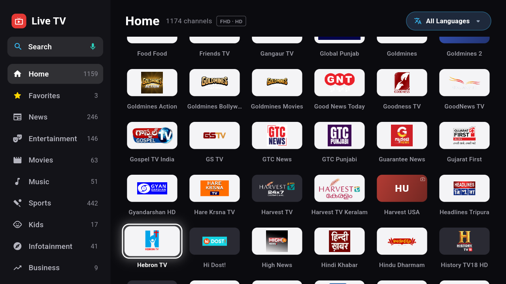

# Open DTH Web TV

<h3 align="center">A Next-Gen Web & Smart TV DTH Live Streaming Player with 4-Hour Timeline EPG</h3>

<p align="center">
  <a href="LICENSE"></a>
  <a href="https://github.com/MandipKumarKanu/open-dth-web-tv"></a>
  
  
  
  
  <a href="https://github.com/MandipKumarKanu"></a>
</p>

---

**Open DTH Web TV** is a high-performance, web-native live TV and DTH streaming application built with **Next.js 16 (App Router & Turbopack)**, **React 19**, **TypeScript**, **Tailwind CSS v4**, and **HLS.js**. 

It brings the authentic Indian Set-Top-Box (STB) experience—reminiscent of Tata Play and Airtel Digital TV—directly into modern web browsers, Smart TVs (Samsung Tizen, LG webOS, Android TV browsers), desktops, tablets, and smartphones. Enjoy 1,100+ free live channels, an interactive 4-hour timeline Electronic Program Guide (EPG) with live background Picture-in-Picture (PIP) video, multi-language audio switching, adaptive resolution selection, smart stream failover, and full TV remote / keyboard / touch navigation.

| | |
|---|---|
|  |  |
| *1,100+ Live Channels categorized with Search & Language Filter* | *Classic 4-Hour Timeline EPG with Program Synopsis & PIP Video* |
|  |  |
| *Full HD Live Playback with Multi-Audio & Fit Controls* | *DTH Program Guide with instant D-pad Genre Switching* |

---

## Key Features

### 1. 1,100+ Curated Live Channels & Smart Discovery
- **Categorized Sidebar**: Seamlessly browse channels by category: **News**, **Entertainment**, **Movies**, **Sports**, **Music**, **Kids**, **Infotainment**, **Business**, **Devotional**, and **Other**, complete with real-time channel counts.
- **12+ Indian Language Filters**: Instantly filter channels by regional languages:
  - 🇮🇳 Hindi, 🌐 English, 🪷 Telugu, 🌴 Tamil, 🐯 Bangla, 🌾 Punjabi, 🏰 Marathi, 🦁 Gujarati, 🎵 Bhojpuri, 📕 Kannada, 🛶 Malayalam.
- **Favorites & Watch History**: Bookmark favorite channels with one click and access automated recently-watched channel history (persisted in local storage).
- **Search Modal & Voice Input**: Integrated search dialog supporting physical keyboard input, on-screen TV remote keyboard, and voice search via the Web Speech API.
- **Smart Generated Channel Icons**: High-contrast, deterministic fallback initials with custom HSL color hashing when channel logos are unavailable.
- **Lazy Loading & Skeleton Placeholders**: Shimmer skeleton animations and `content-visibility: auto` ensure smooth scrolling across thousands of channels with minimal CPU and memory overhead.

### 2. Authentic DTH 4-Hour Timeline Program Guide (EPG)
- **Classic Set-Top-Box Timeline Grid**: Modeled directly after Tata Play and Airtel DTH interfaces with horizontal 30-minute time slots (e.g., 8:00 PM, 8:30 PM, 9:00 PM) spanning a 4-hour paging window.
- **Seamless Picture-in-Picture (PIP) Playback**: The live video broadcast continues playing uninterrupted in the background while you browse the guide.
- **Comprehensive Program Synopsis**: View full program description, genre, timing, duration, season/episode tags, and cast/host details.
- **Live Elapsed Progress Bar**: Visual progress indicator showing exactly how much of a current broadcast has elapsed.
- **Program Reminders & Alert Notifications**: Schedule reminders for upcoming programs. An internal 30-second ticker triggers automated on-screen toast notifications right as your show begins.
- **Quick Category Picker Dialog**: Press Menu / OK to pop up a clean genre modal and jump straight to your desired category.

### 3. Advanced HLS.js Streaming Engine
- **Hardware-Accelerated Live Playback**: Built on `hls.js` for low-latency, glitch-free HLS streaming across Chromium, WebKit, and Gecko browsers.
- **Multi-Bitrate Ladder & Quality Switching**: Choose from `Auto`, `1080p`, `720p`, `576p`, and `480p` with dynamic stream capability detection.
- **Multi-Audio Track Selection**: Channels broadcasting multi-language audio (*Hindi, English, Tamil, Telugu, Spanish, etc.*) automatically display an amber **Audio (🔊)** indicator with an interactive audio track switcher dialog.
- **Auto-Failover & Working Stream Memory**: If a broadcast link experiences a network drop or timeout, the player automatically cascades through alternate backup stream sources and remembers the working URL for subsequent visits.
- **18-Second Wi-Fi Buffer Safety Window**: Ensures jitter-free playback on residential Wi-Fi networks by maintaining a stable live buffer.
- **Aspect Ratio & Screen Fit Modes**:
  - `Fill (16:9)`: 100% full screen with zero black borders.
  - `Contain`: Original broadcast aspect ratio.
  - `Cover`: Cinematic zoom filling wide screens.
- **Last Channel Recall**: Quick-toggle button to immediately swap back to the previously viewed channel.
- **Slide-in Mini Guide**: Browse and tune channels with live "Now Playing" titles without leaving full-screen playback.

### 4. 10-Foot TV Remote, Keyboard & Touch Experience
- **10-Foot Smart TV Ready**: 100% navigable with TV remote D-Pad controls (Up, Down, Left, Right, OK, Back, Menu). Works on Samsung Tizen, LG webOS, and Android TV browsers.
- **Keyboard Shortcuts for Desktop**: Full PC keyboard controls for rapid channel surfing and menu toggling.
- **Touch & Mobile Optimized**: Responsive drawer menus, swipe gestures to change channels, tap-to-reveal controls, and mobile pill filters.
- **Browser History Integration**: Intercepts `popstate` events so the browser back button and remote Back key close dialogs or return to the channel grid rather than navigating away from the app.

### 5. Server-Side APIs with In-Memory Caching
- **`/api/channels`**: Aggregates, deduplicates, and ranks Indian IPTV streams from public catalogs, normalizes tvg-ids and logos, prioritizes Indian channels, and caches results in memory (5-minute TTL).
- **`/api/epg`**: Downloads gzip-compressed XMLTV feeds (`tataplay/epg.xml.gz`), decompresses them on the server using Node.js `zlib`, parses show schedules into a sliding -4h to +28h window, and caches responses (1-hour TTL).

---

## Remote & Keyboard Navigation Cheatsheet

| TV Remote Button | Desktop Keyboard | Action |
|---|---|---|
| **OK / Select** | `Enter` / `Space` | Play selected channel / Toggle player controls / Select item |
| **Up / Down** | `↑` / `↓` | Previous / Next channel (Player) • Move focus (Grid & Guide) |
| **Left / Right** | `←` / `→` | Seek buffer / Switch category / Change timeline window |
| **Menu (☰)** | `M` | Open DTH 4-Hour Timeline Program Guide (EPG) |
| **Channel List / Guide** | `G` | Toggle slide-in Mini Channel Guide |
| **Back / Exit** | `Esc` / `Backspace` | Close modal / Dismiss guide / Return to Home Channel Grid |
| **Search** | `S` | Open channel search dialog |
| **Language** | `L` | Open regional language filter dialog |
| **Aspect Ratio / Fit** | `F` | Cycle screen fit (`Fill 16:9` / `Original` / `Zoom`) |
| **Audio Track** | `A` | Open multi-audio track switcher dialog |
| **Channel +/-** | `Page Up` / `Page Down` | Page up / Page down through channel lists |

---

## Tech Stack

| Layer | Technology |
|---|---|
| **Framework** | [Next.js 16](https://nextjs.org/) (App Router, Turbopack, Partial Prerendering) |
| **UI Library** | [React 19](https://react.dev/) |
| **Language** | [TypeScript 5](https://www.typescriptlang.org/) |
| **Styling** | [Tailwind CSS v4](https://tailwindcss.com/) + Custom TV Design System |
| **Video Engine** | [HLS.js](https://github.com/video-dev/hls.js/) |
| **Icons** | [Lucide React](https://lucide.dev/) |
| **EPG Parser** | Node.js `zlib` gunzip + XMLTV sliding window parser |
| **State & Storage** | React Context + `localStorage` persistence |

---

## Project Structure

```text
open-dth-web-tv/
├── docs/                               # Screenshots & documentation assets
│   ├── live-tv-home.png                # Channel browser screenshot
│   ├── live-tv-epg.png                 # DTH Timeline Guide screenshot
│   └── live-tv-player.png              # Live Player screen screenshot
├── public/                             # Public static assets & icons
├── src/
│   ├── app/
│   │   ├── api/
│   │   │   ├── channels/route.ts       # Server-side IPTV catalog aggregator & cache
│   │   │   └── epg/route.ts            # Server-side XMLTV gzip decompressor & parser
│   │   ├── globals.css                 # TV design system tokens & animation styles
│   │   ├── layout.tsx                  # Root layout with Roboto typography & metadata
│   │   ├── loading.tsx                 # Initial loading skeleton state
│   │   └── page.tsx                    # Main entry page
│   ├── components/
│   │   ├── app-shell.tsx               # View switcher & browser history manager
│   │   ├── home-screen.tsx             # Channel grid, sidebar & categories
│   │   ├── player-screen.tsx           # Full-screen HLS live player & controls
│   │   ├── timeline-guide.tsx          # 4-hour STB timeline program guide
│   │   ├── mini-guide.tsx              # Slide-in quick channel surf drawer
│   │   ├── channel-icon.tsx            # Logo loader with smart fallback hashing
│   │   ├── tv-search-dialog.tsx        # Search dialog with speech voice recognition
│   │   ├── language-dialog.tsx         # Indian regional language selector
│   │   ├── category-picker-dialog.tsx  # STB genre jump modal
│   │   ├── program-details-dialog.tsx  # Show synopsis & reminder manager
│   │   └── tv-audio-track-dialog.tsx   # Multi-audio language picker
│   └── lib/
│       ├── live-tv.ts                  # Channel models, helpers, EPG & formatting utilities
│       └── store.tsx                   # Central store, persistence & reminder ticker
├── next.config.ts                      # Next.js configuration (Turbopack, cacheComponents)
├── package.json                        # Dependencies and scripts
└── tsconfig.json                       # TypeScript compiler configuration
```

---

## Getting Started

### Prerequisites

- [Node.js](https://nodejs.org/) (v18.18.0 or v20+ recommended)
- `npm`, `pnpm`, `yarn`, or `bun`

### 1. Clone the Repository

```bash
git clone https://github.com/MandipKumarKanu/open-dth-web-tv.git
cd open-dth-web-tv
```

### 2. Install Dependencies

```bash
npm install
# or
pnpm install
# or
yarn install
```

### 3. Run Development Server

```bash
npm run dev
```

Open [http://localhost:3000](http://localhost:3000) in your web browser.

### 4. Build for Production

```bash
# Build optimized production bundle
npm run build

# Start production server
npm run start
```

---

## Deployment

### Deploy on Vercel

The easiest way to deploy Open DTH Web TV is using the [Vercel Platform](https://vercel.com/):

[](https://vercel.com/new/clone?repository-url=https%3A%2F%2Fgithub.com%2FMandipKumarKanu%2Fopen-dth-web-tv)

### Self-Hosted / Docker / VPS

You can host this application on any Linux VPS or container using standard Node.js:

```bash
npm run build
NODE_ENV=production PORT=3000 npm run start
```

### Running on Smart TVs

1. Deploy the app to your hosting provider (e.g., Vercel, VPS, or local network IP `http://192.168.x.x:3000`).
2. Open the built-in Web Browser on your **Android TV**, **Google TV**, **Samsung Tizen**, or **LG webOS**.
3. Navigate to your deployed URL and enter full-screen mode.
4. Navigate effortlessly using your standard TV remote D-Pad!

---

## Author & Maintainer

Maintained and developed with ❤️ by **Mandip Kumar Kanu**:
- **GitHub**: [@MandipKumarKanu](https://github.com/MandipKumarKanu)
- **Email**: [mandipshah3@gmail.com](mailto:mandipshah3@gmail.com)

---

## License

This project is licensed under the **MIT License** — see the [LICENSE](LICENSE) file for details.
